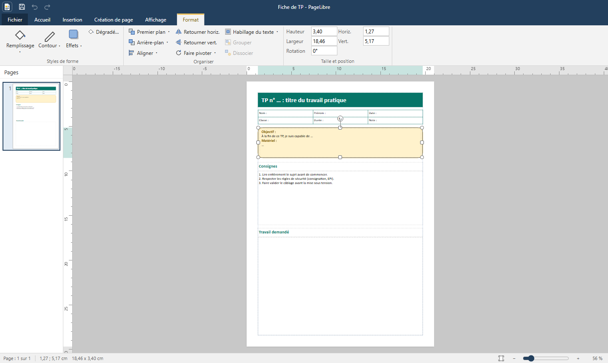
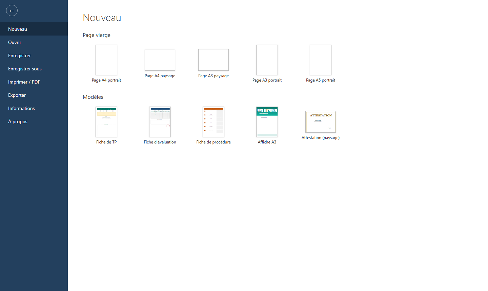

# PageLibre

**Logiciel libre et gratuit de mise en page, dans le navigateur.**
Affiches, fiches, brochures, attestations… avec un ruban, des pages, des cadres de texte et d'image, comme dans un logiciel de PAO classique. Il s'installe comme une application, fonctionne hors connexion, et **vos documents restent sur votre ordinateur**.

👉 **Utiliser PageLibre : https://Michto-p.github.io/pagelibre/**

## Ce que fait PageLibre

- **Mise en page libre** : zones de texte, images (rognage à la souris, corrections), formes, traits et flèches, tableaux (fusion, bordures, diagonales), WordArt, groupes, pages maîtres, numéros de page.
- **Texte soigné** : styles liés, puces et numérotation automatique, lettrines, colonnes, taquets de tabulation (gauche, centré, droite, décimal), césure française, espacement des caractères, cadres chaînés (le texte continue d'un cadre à l'autre), habillage autour des images (carré ou serré).
- **Mise en page précise** : règles, guides magnétiques, grille de mise en page, lignes de base, alignement et répartition, affichage deux pages.
- **Effets** : ombres, lueur, reflet, biseau, profondeur et rotation 3D, dégradés, transparence ; jeux de couleurs et de polices.
- **Modèles prêts à l'emploi** : fiche de TP, fiche d'évaluation, fiche de procédure, affiche A3, attestation.
- **Anciens fichiers .pub** : PageLibre ouvre les fichiers .pub (versions 2003 à 2019) pour continuer à les modifier — y compris les images vectorielles EMF/WMF qu'ils contiennent. Le fichier d'origine n'est jamais modifié.

## Installer l'application

1. Ouvrez **https://Michto-p.github.io/pagelibre/** dans **Microsoft Edge** ou **Google Chrome**.
2. Cliquez sur le bouton jaune **« Installer l'application »** (en haut à droite), ou sur l'icône d'installation dans la barre d'adresse.
3. PageLibre apparaît dans le menu Démarrer, s'ouvre dans sa propre fenêtre et **fonctionne sans Internet**. Les fichiers `.pagelibre` et `.pub` s'ouvrent ensuite d'un double-clic.

Les mises à jour arrivent toutes seules : un message « Nouvelle version disponible » propose de recharger.
Firefox ne sait pas installer d'application sur ordinateur, mais PageLibre y fonctionne normalement dans un onglet.

## Fichiers

| Format | Usage |
|---|---|
| `.pagelibre` | format natif, ouvert (JSON) : pages, styles, images intégrées |
| `.html` | page web autonome : un seul fichier, s'ouvre d'un double-clic et reste modifiable |
| `.png` | export d'une page ou de toutes les pages en images |
| PDF | par l'impression du navigateur (« Enregistrer au format PDF ») ; traits de coupe et fond perdu possibles |
| `.pub` | ouverture seulement (pas d'enregistrement dans ce format) |

## Confidentialité

Aucune donnée n'est collectée : pas de compte, pas de cookies, pas de statistiques, pas de publicité. Tout reste sur votre appareil. Voir [la page Confidentialité](https://Michto-p.github.io/pagelibre/confidentialite.html).

## Développement

- `sources/` : le code (JavaScript sans dépendance, sans étape de compilation).
- `node build.js` : assemble le site dans `docs/` (publié par GitHub Pages) et l'application en un seul fichier `dist/PageLibre.html`.
- `tests/` : tests de bout en bout dans Edge sans fenêtre (`node tests/test_pwa.js`, etc.).

## Licence

PageLibre est un logiciel libre distribué sous licence **GNU GPL version 3 ou ultérieure** : voir [LICENSE](LICENSE).
Vous pouvez l'utiliser, l'étudier, le modifier et le redistribuer ; toute version modifiée diffusée doit rester libre.

---

PageLibre n'est pas affilié à Microsoft. Microsoft et Publisher sont des marques de Microsoft Corporation, citées uniquement pour indiquer la compatibilité des fichiers .pub.
